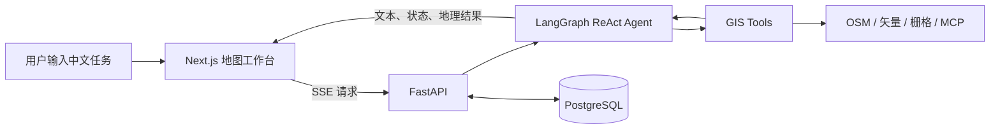

# GeoPilot

GeoPilot 是一个面向空间数据分析的智能 GIS Agent 平台。用户可以通过中文自然语言调用 OSM 数据检索、矢量分析、GDAL 栅格处理等工具，并在 Web 地图中查看分析结果。

本项目基于 MIT 许可的 [NaLaMap](https://github.com/nalamap/nalamap) 进行二次开发，围绕个人项目展示需求重新整理了 Agent 工作流、地图工程管理、中文界面、底图选择、工程导入导出和 QGIS MCP 接入。

## 核心功能

- **空间分析 Agent**：基于 LangGraph 构建 ReAct Agent，通过“模型决策—工具执行—结果回传”循环完成空间分析。
- **状态与上下文管理**：使用自定义 State 管理图层、处理结果和执行步数，并支持历史消息裁剪与摘要。
- **GIS 工具调用**：将 OSM 检索、GeoPandas/Shapely 矢量分析和 GDAL 栅格处理封装为 LangChain Tool，由 Agent 按需调用。
- **MCP 扩展**：支持连接外部 MCP 服务，并提供 Windows 下的 QGIS MCP 启动脚本。
- **流式交互**：FastAPI 通过 SSE 持续返回模型文本、工具状态和地理数据结果。
- **工程持久化**：使用 PostgreSQL 保存地图工程、图层和 Agent 对话记录。
- **工程包导入导出**：地图、数据、图层和 Agent 历史可保存为 `.geopilot` 工程包，并在之后重新导入恢复。
- **地图工作台**：提供中文界面，支持无底图、OpenStreetMap 和 Google Terrain 三种底图模式。
- **可靠性控制**：支持任务超时、取消、异常记录以及 Docker 部署。

## 技术栈

| 模块 | 技术 |
| --- | --- |
| Agent | LangGraph、LangChain、ReAct、MCP |
| 后端 | Python、FastAPI、SSE、SQLAlchemy |
| GIS | GeoPandas、Shapely、GDAL、OSM Nominatim/Overpass |
| 数据库 | PostgreSQL / PostGIS 镜像 |
| 前端 | Next.js、React、TypeScript、Leaflet |
| 部署 | Docker Compose、Nginx |

## 系统流程



## 项目结构

```text
GeoPilot/
├─ backend/              # FastAPI、LangGraph Agent、GIS 工具与数据持久化
├─ frontend/             # Next.js 地图工作台与 Agent 对话界面
├─ nginx/                # 反向代理与 SSE 配置
├─ scripts/              # 本地启动及 QGIS MCP 辅助脚本
├─ docs/                 # 功能说明文档
├─ docker-compose.yml    # Docker 服务编排
├─ start-geopilot.ps1    # Windows 一键启动脚本
└─ .env.example          # 不包含真实密钥的环境变量模板
```

## 快速开始

### 1. 准备环境

需要安装：

- Git
- Docker Desktop（推荐）
- 如需使用 QGIS MCP：QGIS、`uv` 和兼容的 QGIS MCP 插件

### 2. 获取代码

```bash
git clone https://github.com/fan123up/GeoPilot.git
cd GeoPilot
```

### 3. 配置模型

在 PowerShell 中复制环境变量模板：

```powershell
Copy-Item .env.example .env
```

编辑 `.env`，设置要使用的模型供应商及对应 API Key。例如：

```env
LLM_PROVIDER=openai
OPENAI_MODEL=gpt-4o-mini
OPENAI_API_KEY=请填写你自己的密钥
```

只需要配置当前使用的一个模型供应商。真实 `.env` 已被 Git 忽略，不会上传到仓库。

### 4. 启动项目

Windows 推荐在项目根目录执行：

```powershell
.\start-geopilot.ps1
```

脚本会启动 QGIS MCP HTTP 桥接服务，并构建、启动 Docker 服务。启动完成后访问：

- 项目页面：<http://localhost>
- 后端接口文档：<http://localhost:8000/docs>

如果不使用 QGIS MCP，也可以直接启动 Docker：

```powershell
docker compose up -d --build
```

## QGIS MCP 使用方式

首次使用时完成 QGIS MCP 插件安装。之后每次运行只需要：

1. 打开 QGIS。
2. 在 QGIS MCP 面板中点击 **Start Server**。
3. 在项目根目录运行 `.\start-geopilot.ps1`。
4. 打开 GeoPilot，Agent 会使用预设地址连接 QGIS MCP。

默认桥接地址为 `http://host.docker.internal:18001/mcp`，无需每次在 GeoPilot 中重新填写。

## 工程包使用方式

- 在地图工程区域输入工程名称并保存。
- 点击导出，将当前地图、数据、图层和 Agent 对话历史下载为 `.geopilot` 文件。
- 再次使用时导入该工程包，即可恢复之前的工作状态。

工程包可能包含用户上传的数据和对话内容，请根据数据敏感程度妥善保存，不要直接提交到公共仓库。

## 安全说明

- 仓库只提供 `.env.example`，不包含真实 API Key。
- `.env`、`.env.local`、运行日志、上传数据、缓存和本地运行目录均已排除。
- 不要把密钥直接写入源代码或提交到 Git。
- 如果密钥曾经进入 Git 历史，应立即在对应平台撤销并重新生成。

## 项目说明

这是一个持续迭代的个人项目，当前重点是展示 Agent 编排、GIS 工具调用、流式交互、工程持久化及 MCP 扩展能力。部分高级配置保留在代码中，但不作为默认演示流程。

## 许可证

项目遵循 [MIT License](LICENSE)。感谢 NaLaMap 及相关开源项目提供的基础实现。
